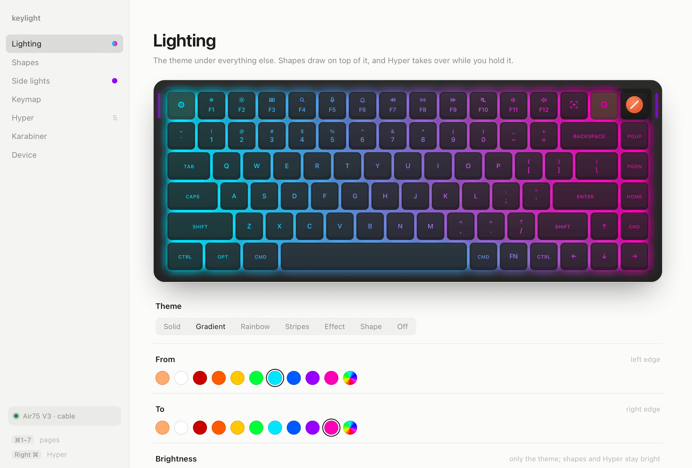
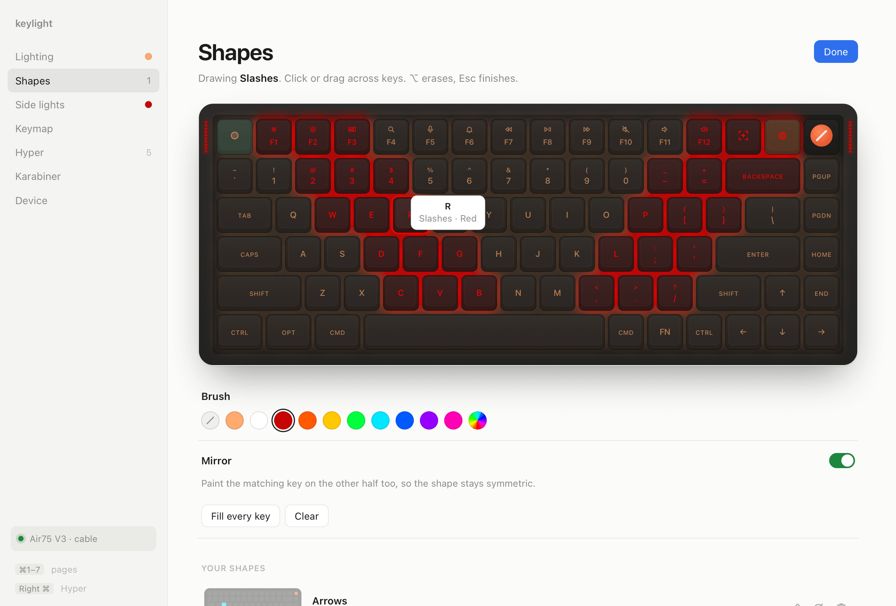
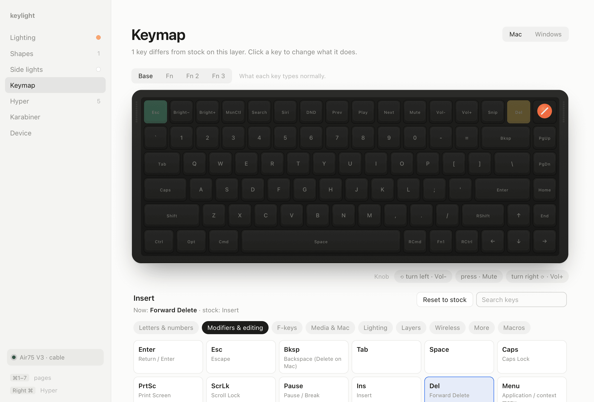
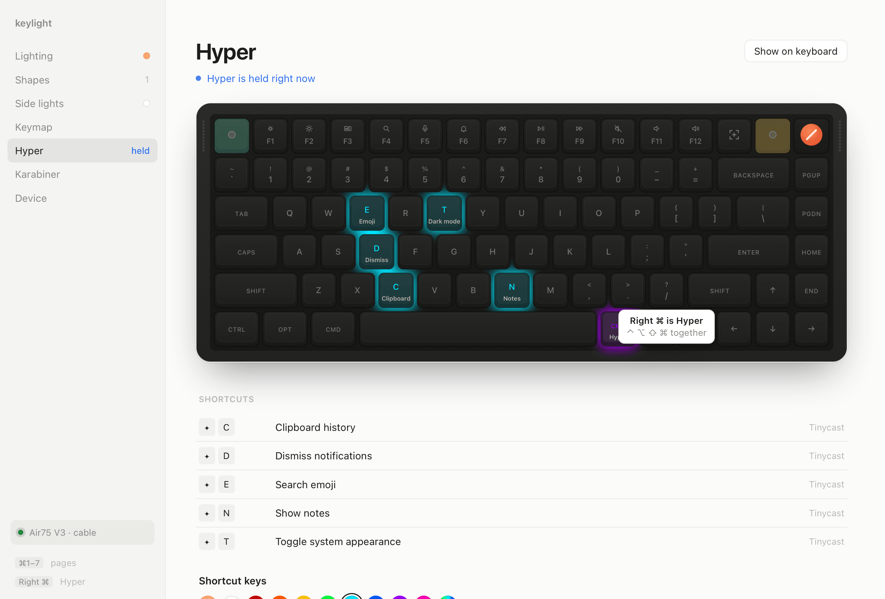
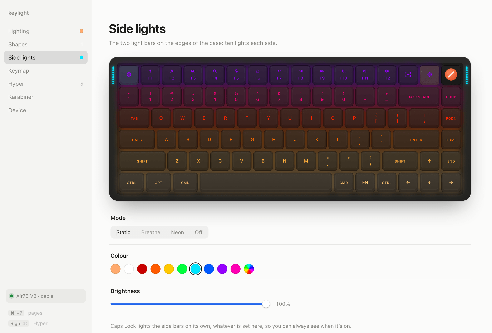
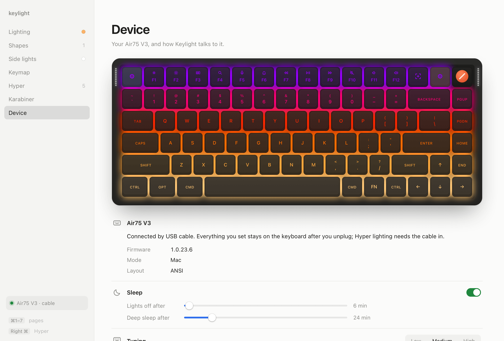
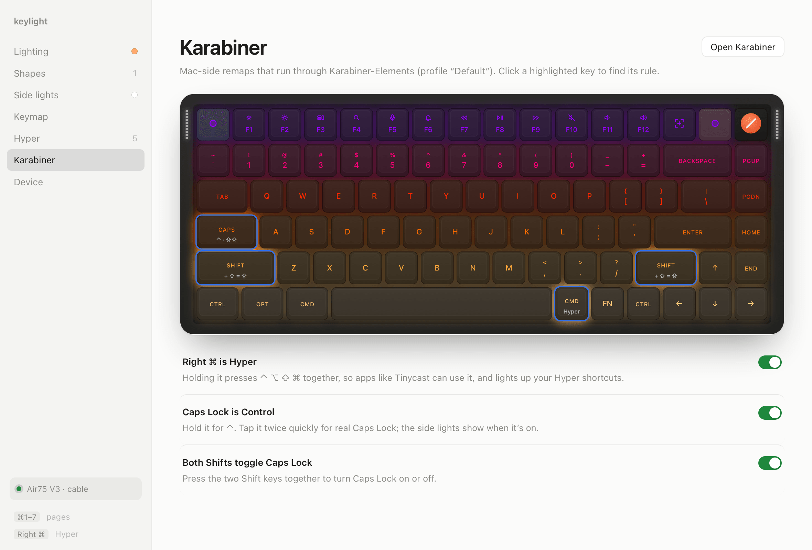

# Keylight

A Mac app for NuPhy keyboards: lighting, keymaps and Hyper-key shortcuts, set over the USB cable. It's made on the Air75 V3; other NuPhy IO boards are experimental (see [Supported boards](#supported-boards)).



Website: [nuphy.kelvinamoaba.com](https://nuphy.kelvinamoaba.com)

## Features

- **Lighting.** Solid colour, gradient, rainbow or one colour per row, plus the keyboard's 19 built-in effects and 8 built-in shapes, with speed, direction and brightness.
- **Shapes.** Paint keys by hand, with a mirror mode, or start from a preset. Shapes are layers drawn on top of the theme, and each one can be hidden.
- **Side lights.** Static, breathe, neon or off, in any colour.
- **Keymap.** Remap any key on any of the eight layers, four for Mac mode and four for Windows. The knob's left turn, right turn and press are keys too. Keylight backs up your whole keymap before the first change.
- **Macros.** Record a macro by typing it, or build it key by key, for each of the 32 slots in Mac and Windows mode. Name them, see which keys play them, and put one on a key in two clicks. Keylight backs up your keymap and macros before the first change.
- **Advanced keys.** SOCD pairs (hold A and D, pick which one types), Tap Dance (a tap, a double tap and a hold on one key) and Toggle (tap to switch a layer or key on, tap again to switch it off). Click a key on the board to make one.
- **Hyper highlighting.** Hold Right ⌘ and only the keys you've bound to Hyper shortcuts light up. Click keys to mark them. If you use Tinycast, Keylight reads its Hyper shortcuts for you.
- **Karabiner setup.** One click adds three Karabiner-Elements rules: Right ⌘ as Hyper, Caps Lock as Control with a double-tap for Caps Lock, and both Shifts together for Caps Lock.
- **Device settings.** Auto-sleep timers, the typing filter against key chatter, and open at login. It also shows the firmware version and whether the keyboard is in Mac or Windows mode.
- **More boards, experimental.** The Air65 V3, Air100 V3, Kick75, Node75, Node100 and Halo V2 are detected and drawn in their own layouts, and Keylight can set their lighting. **Copy diagnostics** on the Device page copies what a tester needs to send us.
- **Menu bar.** Closing the window leaves Keylight in the menu bar with a few quick themes.
- **Command line.** A `keylight` command and a local socket, for scripts and Karabiner.

| | |
|---|---|
|  |  |
|  |  |
|  |  |

## Requirements

- macOS 13 or later.
- A NuPhy Air75 V3, or one of the experimental boards below, connected with the **USB cable**. The 2.4G dongle and Bluetooth only carry keystrokes, so Keylight can't change settings through them. You can keep typing over either one; Keylight saves your settings and applies them the next time the cable is plugged in.
- [Karabiner-Elements](https://karabiner-elements.pqrs.org), only for the Hyper key and the Caps Lock rules.

I have tested Keylight on the ANSI Air75 V3 with firmware 1.0.23.6. ISO and JIS boards are drawn in their own layouts too, picked from the USB product ID; if that's wrong, choose the layout on the Device page. Their LED and key maps come from NuPhy IO's data and haven't been checked on a real ISO or JIS board yet.

## Supported boards

Keylight tells boards apart by their USB product ID (System Information → USB), not by name, because NuPhy uses "V2" for two different kinds of board.

| Board | USB product IDs | Status |
|---|---|---|
| Air75 V3 (ANSI, ISO, JIS) | 0x1028, 0x102A, 0x1029 | Supported |
| Air65 V3 (ANSI, ISO, JIS) | 0x102B, 0x1040, 0x1042 | Experimental |
| Air100 V3 (ANSI, ISO, JIS) | 0x102D, 0x1039, 0x103F | Experimental |
| Kick75, Kick75 High | 0x1026, 0x1027 | Experimental |
| Node75 LP (ANSI, ISO, JIS) | 0x1030, 0x1034, 0x1032 | Experimental |
| Node75 HP (ANSI, ISO, JIS) | 0x1031, 0x1035, 0x1033 | Experimental |
| Node100 LP (ANSI, ISO, JIS) | 0x1037, 0x103B, 0x103C | Experimental |
| Node100 HP (ANSI, ISO, JIS) | 0x1036, 0x1038, 0x103A | Experimental |
| Halo65, Halo75, Halo96 V2, the NuPhy IO ones (ISO for 75 and 96) | 0x102F, 0x102C, 0x102E, 0x1043, 0x1044 | Experimental |
| Air60, Air75 and Air96 V2, Gem80, Halo V2 and Kick75 on QMK | 0x3255, 0x3246, 0x3266, 0x3275, 0x3315, 0x32F5, 0x3302, 0x32D5 | Not supported yet |

**Experimental** means Keylight connects, reads the board and draws it, with an Experimental badge on the Device page. It writes nothing until you turn on **Experimental lighting** there, and only if the board answered the way Keylight expects: its LED count, key matrix and light state. Then it sets the lighting: themes, shapes, effects and side lights. Keymaps, macros, advanced keys and settings stay read-only on these boards for now. Their layouts and LED maps come from NuPhy IO's data and haven't been checked on a real board, so a key may light up in the wrong place. If you own one, **Copy diagnostics** on the Device page and paste it into an issue.

The QMK boards speak VIA, a different protocol, and need their own driver. Keylight sees them but doesn't open them.

## Install

### Homebrew

```sh
brew tap amoabakelvin/tap
brew trust amoabakelvin/tap
brew install --cask keylight
```

### Download

Get `Keylight.app` from [Releases](https://github.com/AmoabaKelvin/keylight/releases/latest) and move it to Applications. It runs on Apple silicon and Intel Macs. From 0.2.0 on, Keylight updates itself: it looks for a new version once a day, and Device → Updates checks on demand.

Releases aren't signed yet, so macOS blocks the first launch. Right-click the app and choose **Open**. On macOS 15 and later that no longer works; open the app once, then click **Open Anyway** in System Settings → Privacy & Security. Or clear the quarantine flag:

```sh
xattr -dr com.apple.quarantine /Applications/Keylight.app
```

### Build from source

You need Node.js, pnpm, a recent stable Rust toolchain and the Xcode Command Line Tools.

```sh
pnpm i
pnpm app:build
```

The app is written to `src-tauri/target/release/bundle/macos/Keylight.app`. For development, `pnpm app` runs it with hot reload.

## Command line

The app's executable is also a command. Most commands talk to the running app, so open Keylight first.

```sh
alias keylight=/Applications/Keylight.app/Contents/MacOS/keylight

keylight hyper on              # light only the Hyper keys (Karabiner sends this while Right ⌘ is held)
keylight hyper off
keylight caps-toggle           # flip Caps Lock through macOS, so the keyboard's caps light follows
keylight setup-karabiner       # add Keylight's Karabiner rules
keylight send '{"op":"base","name":"rainbow"}'
keylight send '{"op":"state"}' # print the full state as JSON
```

`keylight send` passes one JSON message to the app, in the same format the app's own window uses. Some examples:

```sh
keylight send '{"op":"base","name":"solid","color":[255,170,110],"level":60}'
keylight send '{"op":"base","name":"effect","mode":6,"speed":2}'
keylight send '{"op":"side","mode":3,"color":[0,120,255]}'
keylight send '{"op":"layer","name":"todo","keys":["t","o","d"],"color":[255,0,0]}'
```

The full list of operations is in `Engine::handle` in [`src-tauri/src/engine.rs`](src-tauri/src/engine.rs).

The app listens on a Unix socket at `~/Library/Application Support/Keylight/keylight.sock`. Each connection takes one JSON message and gets one line back: `ok`, a JSON value, or `error: ...`.

```sh
echo '{"op":"state"}' | nc -U ~/Library/Application\ Support/Keylight/keylight.sock
```

## Safety

Keylight writes to your keyboard's memory, so it limits what it can send:

- **An allowlist of 23 commands.** Every packet goes through one function, and it refuses any command not on the list. The list covers device info, the LED count and LED colours (reads), lighting, per-key colour, keymap, macros, the SOCD, Tap Dance and Toggle tables, typing and sleep settings, and the session handshake. See `ALLOWED` in [`src-tauri/src/hid.rs`](src-tauri/src/hid.rs).
- **Experimental boards are read first.** On a board other than the Air75 V3, Keylight only reads until you turn on experimental lighting, and even then only if the board's answers match its data. It then sends the same lighting commands it sends the Air75 V3, and nothing else.
- **Never bootloader, reset or wipe.** Firmware update mode `0xEF`, factory reset `0xF1`, and the keymap and advanced-key wipes `0xB4`, `0xB7`, `0xBA` and `0xBD` are not on the list, so Keylight can't send them. It writes advanced keys one entry at a time, and clears an unused entry by writing zeros.
- **Keymap backup before the first write.** Before it changes a key, Keylight saves all eight layers, both macro banks and the three advanced-key tables to `~/Library/Application Support/Keylight/backups/`.
- **Karabiner backup.** The first time Keylight edits `karabiner.json`, it copies the original to `karabiner.json.keylight-backup` next to it.
- **Few writes.** Lighting changes send only the keys that changed. Keylight doesn't animate anything in software, because I don't know whether the keyboard saves every write to flash.

## How it works

Keylight is a [Tauri 2](https://tauri.app) app. The Rust side talks to the keyboard's vendor HID interface over USB with [hidapi](https://github.com/ruabmbua/hidapi-rs), and runs a socket for the command line. The window is React. The app keeps a stack of layers: the theme, your shapes, an unsaved preview, and your Hyper keys while Right ⌘ is held. It works out what each key should show and writes only the difference.

NuPhy doesn't publish the protocol. I worked it out from NuPhy IO, NuPhy's web configurator, and from the keyboard's firmware, and wrote it up here:

- [docs/PROTOCOL.md](docs/PROTOCOL.md): packet format, the command table, lighting, sleep and typing settings, and which commands are dangerous.
- [docs/KEYMAP.md](docs/KEYMAP.md): the key matrix, stock keymaps, keycodes, macros, advanced keys and how restoring defaults works.

## Roadmap

- An in-app firmware updater
- Research into custom firmware
- Keymaps and macros on the experimental boards, and checking their LED maps with testers
- A driver for NuPhy's QMK boards (Air75 V2 and friends)
- Signed and notarized releases

## Contributing

Issues and pull requests are welcome. The most useful help comes from people who own:

- **An ISO or JIS Air75 V3.** Keylight draws both, but I've only checked the LED and key-matrix maps on ANSI. An issue saying which keys light up wrong, or a screenshot of the Keymap page, is enough to start.
- **Another NuPhy keyboard.** Plug it in, open the Device page, click **Copy diagnostics** and paste the result into an issue. It holds the USB product ID, firmware version, LED count, key matrix and light state. For boards Keylight doesn't detect, send the USB product ID and the firmware version NuPhy IO shows.

When you change the protocol code, keep to commands already documented in `docs/PROTOCOL.md`, and never add one to the allowlist without knowing what it does.

## Disclaimer

Keylight is unofficial and not affiliated with or endorsed by NuPhy. NuPhy, Air75 and the other keyboard names are trademarks of their owners. Use it at your own risk.

## License

[MIT](LICENSE) © 2026 Kelvin Amoaba
